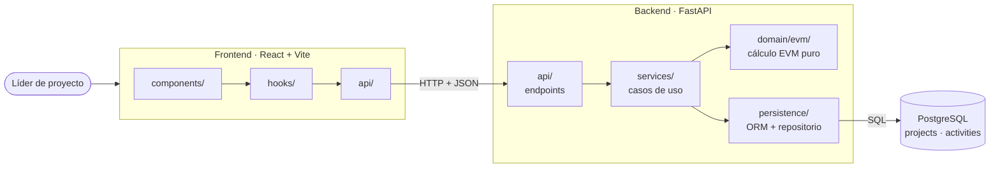
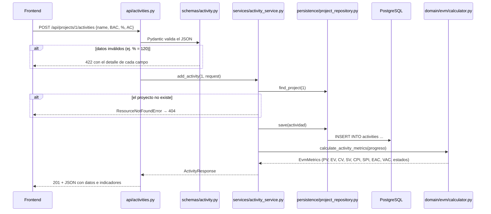
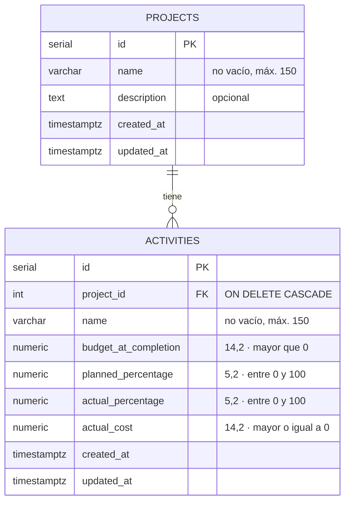
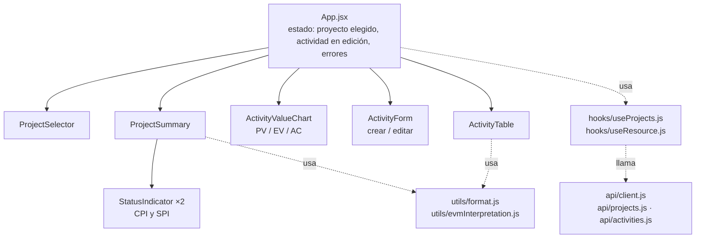
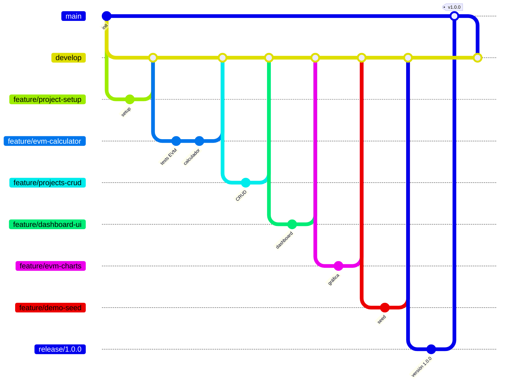

# Arquitectura de EVM Tracker

EVM Tracker es una aplicación web de tres piezas: un **frontend** en React que el líder de proyecto usa en el navegador, un **backend** en FastAPI que expone un API REST y calcula los indicadores de Valor Ganado, y una **base de datos** PostgreSQL que guarda proyectos y actividades.

La decisión central: **el cálculo EVM vive en un solo lugar** (`backend/app/domain/evm/`), sin depender del framework web ni de la base de datos. Todo lo demás existe para llevarle datos y mostrar sus resultados.

---

## 1. Backend

### 1.1 Capas

El backend está organizado en capas. Cada una tiene una responsabilidad y solo conoce a la que está debajo.

| Capa | Carpeta | Responsabilidad | Lo que **no** hace |
|---|---|---|---|
| API | `app/api/` | Recibe la petición HTTP, valida el formato, llama al servicio y devuelve la respuesta con su código (200, 201, 204, 404, 422) | No calcula ni decide nada de negocio |
| Contratos | `app/schemas/` | Define la forma exacta de cada request y response (Pydantic) y sus validaciones | No accede a la base de datos |
| Servicios | `app/services/` | Casos de uso: "crear actividad", "consultar proyecto". Busca los datos, invoca el dominio y arma la respuesta | No sabe de HTTP |
| Dominio | `app/domain/evm/` | Las fórmulas EVM, el consolidado, el redondeo y la interpretación de CPI y SPI | No sabe que existen FastAPI ni PostgreSQL |
| Persistencia | `app/persistence/` | Modelos ORM (tablas) y repositorio (consultas) | No calcula indicadores |
| Núcleo | `app/core/` | Configuración (`.env`) y conexión a la base de datos | — |

**Por qué así:** el enunciado pide que "la lógica de negocio no viva en los controladores". Separar el dominio permite probar las fórmulas en milisegundos, sin levantar servidor ni base de datos, y cambiar FastAPI por otro framework sin tocar `calculator.py`.

### 1.2 Recorrido de una petición

Así viaja `POST /api/projects/1/activities`, la creación de una actividad:

### 1.3 El dominio EVM

Archivos en `app/domain/evm/`:

| Archivo | Contenido |
|---|---|
| `models.py` | `ActivityProgress` (entrada: BAC, % planificado, % real, AC, con sus validaciones), `EvmMetrics` (resultado) y los enums `CostStatus` y `ScheduleStatus` |
| `calculator.py` | `calculate_activity_metrics` y `calculate_project_metrics` |
| `constants.py` | Precisión de redondeo, base 100 de los porcentajes, índice objetivo 1 (sin números mágicos en el código) |

**Fórmulas**

| Indicador | Fórmula | Qué responde |
|---|---|---|
| PV · Valor planificado | % planificado × BAC | ¿Cuánto trabajo debía estar hecho hoy, en dinero? |
| EV · Valor ganado | % real × BAC | ¿Cuánto trabajo está hecho de verdad, valorado al precio del plan? |
| AC · Costo real | dato de entrada | ¿Cuánto se ha gastado? |
| CV · Variación de costo | EV − AC | ¿Gané más o menos de lo que gasté? |
| SV · Variación de cronograma | EV − PV | ¿Voy adelante o detrás del plan? |
| CPI · Índice de costo | EV / AC | ¿Cuánto valor genero por cada peso gastado? |
| SPI · Índice de cronograma | EV / PV | ¿A qué ritmo avanzo frente al plan? |
| EAC · Estimado al terminar | BAC / CPI | Si sigo con esta eficiencia, ¿cuánto costará todo? |
| VAC · Variación al terminar | BAC − EAC | ¿Cuánto me pasaré (o ahorraré) al final? |

**Interpretación:** índice > 1 → bajo presupuesto / adelantado; = 1 → en presupuesto / a tiempo; < 1 → sobre presupuesto / atrasado.

**Decisiones del cálculo**

1. **Consolidado ponderado, no promediado.** El proyecto suma BAC, PV, EV y AC de sus actividades y aplica las fórmulas a esos totales. Ejemplo: una actividad de 10.000 con CPI 0,67 y otra de 20.000 con CPI 1,4 dan un CPI de proyecto de **1,0** (11.000 / 11.000), no de 1,03 (el promedio simple), porque la segunda pesa el doble.
2. **Divisiones no definidas → `null`.** Si AC = 0 no hay CPI; si PV = 0 no hay SPI; si el CPI es 0 o no existe, no hay EAC ni VAC. El API devuelve `null` con estado `NOT_AVAILABLE`, nunca un error 500 ni infinito.
3. **Precisión decimal y redondeo al final.** Se usa `Decimal`, no `float`, para que 0,1 + 0,2 sea exactamente 0,3. Se calcula con precisión completa y solo se redondea al construir el resultado: 2 decimales para dinero y 4 para índices, con el modo HALF_UP. Por eso el EAC usa el CPI exacto. Con el CPI redondeado, BAC 300 y CPI 0,3333 darían 900,09 en lugar de 900,00.
4. **La interpretación compara el índice ya redondeado**, para que lo que se muestra (1,0000) y su estado ("en presupuesto") nunca se contradigan.

### 1.4 Modelo de datos

- **Los indicadores no se guardan.** Son datos derivados: se calculan en cada consulta, así que no pueden quedar desactualizados.
- **Las reglas se validan en tres lugares, a propósito:** en Pydantic (para responder 422 con un mensaje claro), en el dominio (`ActivityProgress` no acepta valores inválidos aunque alguien llame al cálculo sin pasar por el API) y en la base de datos (restricciones `CHECK`, la última línea de defensa).
- `db/init.sql` crea el esquema y `db/seed.sql` carga datos de demostración. El seed es **idempotente**: ejecutarlo dos veces no duplica nada.

### 1.5 Contrato del API

| Método | Ruta | Éxito | Errores |
|---|---|---|---|
| GET | `/api/projects` | 200 · lista con el consolidado de cada proyecto | — |
| POST | `/api/projects` | 201 · proyecto creado | 422 |
| GET | `/api/projects/{id}` | 200 · proyecto + actividades con indicadores + consolidado | 404 |
| PUT | `/api/projects/{id}` | 200 | 404, 422 |
| DELETE | `/api/projects/{id}` | 204 · borra también sus actividades | 404 |
| POST | `/api/projects/{id}/activities` | 201 · actividad con indicadores | 404, 422 |
| PUT | `/api/projects/{id}/activities/{activityId}` | 200 · indicadores recalculados | 404, 422 |
| DELETE | `/api/projects/{id}/activities/{activityId}` | 204 | 404 |

- Documentación interactiva en `/swagger-ui` y especificación OpenAPI en `/api-docs`, generadas por FastAPI a partir de los esquemas Pydantic.
- Los errores 404 tienen un formato único: `{"detail": "Proyecto 7 no existe."}`.
- Las validaciones responden **422** (el estándar de FastAPI para datos con formato válido que no cumplen las reglas), no 400.
- Los montos se envían como números JSON (`5000.0`), no como texto.
- Editar es `PUT` (reemplaza el recurso completo), no `PATCH`.

---

## 2. Frontend

| Carpeta | Responsabilidad |
|---|---|
| `api/` | Única puerta al backend. `client.js` arma la petición, convierte errores 404 y 422 en mensajes legibles y detecta si el backend no responde |
| `hooks/` | `useResource` carga datos, expone `reload` y descarta respuestas viejas si llegan fuera de orden |
| `components/` | Piezas visuales; reciben datos por props y avisan acciones por callbacks |
| `utils/` | Formato de dinero, índices y porcentajes (`es-CO`), y textos de interpretación ("por cada $1 gastado…") |
| `constants/` | Etiquetas y colores de cada estado, y la lista de indicadores que se muestran |

**Decisiones del frontend**

- **No recalcula EVM.** Solo muestra lo que devuelve el API, para que la lógica no exista duplicada en Python y en JavaScript.
- **"Tiempo real" = recargar después de cada cambio.** Al guardar, crear o eliminar, se vuelven a pedir el proyecto y la lista. Es simple y siempre muestra lo que dice el servidor; no hace falta WebSockets para un solo usuario editando.
- **Un mensaje de estado general** encima de los indicadores ("El proyecto va bien…" / "Atención…") responde al requisito de "entender de un vistazo si el proyecto va bien o mal".
- **Colores con significado:** verde = bien, rojo = mal, gris = sin datos.

---

## 3. Pruebas y calidad

| Tipo | Dónde | Qué valida | Cantidad |
|---|---|---|---|
| Unitarias | `backend/tests/unit/` | Fórmulas con números calculados a mano, casos borde (AC = 0, avance real 0, sin actividades), ponderación del consolidado, redondeo y validaciones | 24 |
| Integración | `backend/tests/integration/` | Cada endpoint: código HTTP, forma exacta del JSON, 404 y 422 | 22 |

- **Cobertura** de la capa de negocio (`domain` + `services`): 100 %. El build falla si baja de 80 % (`fail_under` en `pyproject.toml`).
- **Las pruebas de integración usan SQLite en memoria** para correr en cualquier máquina sin configurar nada. La desventaja es que no prueban las particularidades de PostgreSQL. Ese riesgo se cubrió probando manualmente contra PostgreSQL real.
- **Linters:** Ruff en el backend (incluye reglas contra números mágicos, código comentado y argumentos sin usar) y ESLint en el frontend.

---

## 4. Flujo de trabajo (Gitflow)

Cada funcionalidad se trabajó en su rama `feature/*` y entró a `develop` por un Pull Request. El release preparó la versión, se integró a `main` con el tag `v1.0.0` y volvió a `develop`.

---

## 5. Glosario de conceptos

| Concepto | Qué es | Dónde aparece aquí |
|---|---|---|
| **API REST** | Forma de exponer operaciones por HTTP usando recursos (`/projects`) y verbos (GET, POST, PUT, DELETE) | `app/api/` |
| **Código de estado HTTP** | Número que resume el resultado: 200 OK, 201 creado, 204 sin contenido, 404 no existe, 422 datos inválidos, 500 error del servidor | Respuestas del API |
| **OpenAPI / Swagger** | Especificación estándar que describe un API (rutas, esquemas, errores); Swagger UI la muestra y permite probarla | `/swagger-ui`, `/api-docs` |
| **Arquitectura en capas** | Dividir el código por responsabilidad, cada capa apoyada en la de abajo | `api → services → domain / persistence` |
| **Dominio** | El código que representa las reglas del problema (aquí, EVM), independiente de la tecnología | `app/domain/evm/` |
| **DTO / esquema** | Objeto que define la forma de los datos que entran y salen del API | `app/schemas/` |
| **Pydantic** | Librería que valida datos según tipos y reglas y genera los esquemas de OpenAPI | `schemas/*.py` |
| **ORM** | Mapea tablas a clases de Python, para trabajar con objetos en lugar de SQL a mano | `persistence/models.py` (SQLAlchemy) |
| **Patrón repositorio** | Clase que encapsula las consultas a la base, así los servicios no escriben SQL | `persistence/project_repository.py` |
| **Inyección de dependencias** | El framework entrega a cada endpoint lo que necesita (sesión de BD, servicio) en lugar de que el endpoint lo cree | `api/dependencies.py` (`Depends`) |
| **Dato derivado** | Valor que se calcula a partir de otros y por eso no se guarda | Los indicadores EVM |
| **Idempotente** | Operación que da el mismo resultado si se ejecuta una o varias veces | `db/seed.sql` |
| **Decimal vs float** | `float` tiene errores binarios (0,1 + 0,2 ≠ 0,3); `Decimal` es exacto, necesario para dinero | Todo el cálculo |
| **Prueba unitaria** | Prueba una función aislada, sin red ni base de datos | `tests/unit/` |
| **Prueba de integración** | Prueba varias piezas juntas a través de su interfaz real (aquí, peticiones HTTP) | `tests/integration/` |
| **TDD** | Escribir primero la prueba que falla y luego el código que la hace pasar | Rama `feature/evm-calculator` (commit de pruebas antes que el de código) |
| **Cobertura** | Porcentaje de líneas ejecutadas por las pruebas | `pytest --cov` |
| **Linter** | Herramienta que detecta errores y malas prácticas sin ejecutar el código | Ruff, ESLint |
| **CORS** | Regla del navegador que impide que una web llame a otro dominio sin permiso; el backend autoriza `localhost:5173` | `app/main.py` |
| **Hook (React)** | Función que da estado o efectos a un componente; `useResource` es uno propio | `frontend/src/hooks/` |
| **Props y callbacks** | Los datos bajan del padre al hijo como props; las acciones suben como funciones | `App.jsx` → componentes |
| **Gitflow** | Modelo de ramas: `main` (producción), `develop` (integración), `feature/*`, `release/*` | Historial del repo |
